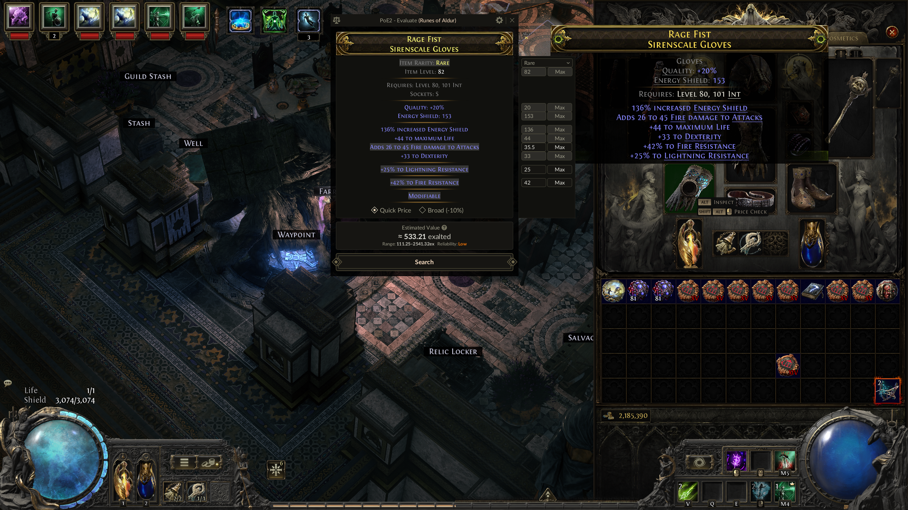

# Retinue

In-game overlays and tools for Warframe and Path of Exile 2 on Linux/Proton.

## Warframe

Relic rewards, relic recommendations and ducat-kiosk prices in-game. Foundry,
Mastery Helper, Inventory, Relic Planner, Market and build planning in the desktop app.


[Companion features](https://zeewanderer.github.io/retinue/guides/companion/) | [Desktop app](https://zeewanderer.github.io/retinue/guides/gui/)

## Path of Exile 2

Hover an item and press **Alt+E** to check prices, edit trade filters or open the
trade website. Optional estimates help gauge equipment value.



[PoE2 features and setup](https://zeewanderer.github.io/retinue/guides/poe2/)

## Install

Companion overlays require KDE Plasma on Wayland. Install with [Homebrew](https://brew.sh):

```bash
brew tap zeewanderer/sundries
brew install zeewanderer/sundries/retinue
```

Follow [installation and Steam setup](https://zeewanderer.github.io/retinue/guides/installation/), then run
`retinue doctor` to check the setup.

## Tools

- `retinue`: shared CLI and daemon controls. `wfcli` and `poe2cli` select a game.
- `wfgui`: Warframe desktop app.
- `retinue-inspect`: memory, capture and game-research tools.
- `retinue mcp`: MCP server.

ARC Raiders currently has [launch scaffolding only](https://zeewanderer.github.io/retinue/guides/arc/).

## Documentation

[Documentation](https://zeewanderer.github.io/retinue/) | [Commands](https://zeewanderer.github.io/retinue/guides/cli/)
| [Build from source](https://zeewanderer.github.io/retinue/developer/workflows/#build)
| [Contributing](https://zeewanderer.github.io/retinue/developer/)

## License

Project code is licensed under Apache-2.0; see [LICENSE.md](LICENSE.md). Third-party components
and assets retain their own terms. Warframe assets are used under the
[Warframe Content Policy](https://www.warframe.com/en/contentpolicy); provenance notes live beside
the relevant files.
