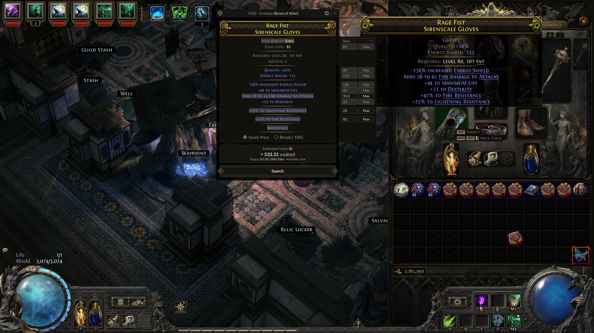

# Retinue

Linux/Proton game companions with a shared daemon, CLI, and MCP server.

## Warframe

Relic rewards, relic recommendations and ducat-kiosk prices in-game. Foundry,
Mastery Helper, Inventory, Relic Planner, Market and build planning in the desktop app.


[Companion features and setup](docs/companion.md) | [Desktop GUI](docs/gui.md)

## Path of Exile 2

Hover an item and press **Alt+E** to check prices, edit trade filters or open the
trade website. Optional estimates help gauge equipment value.



[PoE2 features and setup](docs/poe2.md)

## Install

Companion overlays require KDE Plasma on Wayland. Install with [Homebrew](https://brew.sh):

```bash
brew tap zeewanderer/sundries
brew install zeewanderer/sundries/retinue
```

Follow [installation and Steam setup](docs/installation.md), then run
`retinue doctor` to check the setup.

## Tools

- `retinue`: shared CLI and daemon controls. `wfcli` and `poe2cli` select a game.
- `wfgui`: Warframe desktop app.
- `retinue-inspect`: memory, capture and game-research tools.
- `retinue mcp`: MCP server.

ARC Raiders currently has [launch scaffolding only](docs/arc.md).

## Documentation

[All guides](docs/index.md) | [CLI](docs/cli.md) | [Build from source](docs/developer/workflows.md#build)
| [Contributing](docs/DEVELOPER.md)

## License

Project code is licensed under Apache-2.0; see [LICENSE.md](LICENSE.md). Third-party components
and assets retain their own terms. Warframe assets are used under the
[Warframe Content Policy](https://www.warframe.com/en/contentpolicy); provenance notes live beside
the relevant files.
