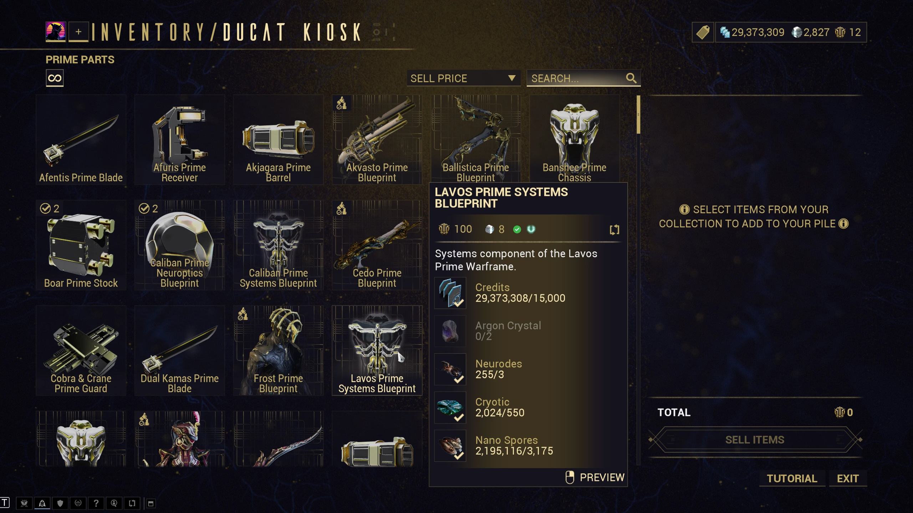

# Retinue

Linux/Proton game companions with a shared daemon, CLI, and MCP server. Warframe includes
a desktop GUI, relic and ducat-kiosk overlays, Market tools, and build planning.
Path of Exile 2 includes an in-game price checker with editable trade filters and estimates.

## Applications

| Application | Purpose |
| --- | --- |
| [`retinue`](docs/cli.md) | Game-scoped terminal commands, daemon controls, and stdio MCP entrypoint |
| `wfcli`, `poe2cli`, `arccli` | Game-scoped aliases for `retinue` |
| [`retinue-daemon`](docs/daemon.md) | Shared service host with separate Warframe and PoE2 supervisors |
| [`wfcompanion`](docs/companion.md) | Warframe observer and Wayland overlay |
| [`poe2companion`](docs/poe2.md) | Path of Exile 2 observer and Evaluate price-check overlay |
| [`arccompanion`](docs/arc.md) | ARC Raiders launch scaffold; observation not implemented |
| [`wfgui`](docs/gui.md) | Native Qt desktop client for Warframe account and world-state views |
| [`retinue-inspect`](docs/wfinspect.md) | Generic memory/capture inspection and Warframe research; `wfinspect` is an alias |

Clients start `retinue-daemon` when needed. Concurrent clients reuse its caches and rate-limited work.
The [project structure](docs/developer/structure.md) describes OTP libraries and ownership.

## Desktop GUI

`wfgui` provides Foundry, Mastery Helper, Inventory, Relic Planner, and Market views alongside
live world timers and fissures.


## In-game Overlays

`wfcompanion` adds Market values and collection progress to relic rewards, ranks owned relics
during selection, and shows prices and collection badges in ducat-kiosk tooltips.




In Path of Exile 2, hover an item and press **Alt+E** to compare asking prices, adjust search
filters, or open the trade website. See the [PoE2 guide](docs/poe2.md).

## Install

Install with [Homebrew](https://brew.sh) on Linux:

```bash
brew tap zeewanderer/sundries
brew install zeewanderer/sundries/retinue
```

Upgrading from `wfcli`? Follow [storage migration](docs/data-sources.md#migrate-wfcli-storage)
to retain settings and saved builds. Source builds are covered [below](#build).

### Steam launch mode

Find the installed companion:

```bash
command -v wfcompanion
```

Set **Warframe > Properties > General > Launch Options** in Steam using that absolute path:

```text
/absolute/path/to/wfcompanion launch -- %command%
```

Start `retinue-daemon` from the host before launching Warframe; Proton-side startup is not recommended:

```bash
retinue daemon ensure
```

Launch mode starts the companion with Warframe and reuses `retinue-daemon`. See the
[companion guide](docs/companion.md) for automatic Steam configuration and overlay controls.
PoE2 has its own [companion setup](docs/poe2.md).

### Desktop launcher

Register the GUI in the desktop application menu and install its notification identity:

```bash
wfcli gui install
```

### Daemon service (optional)

Normal CLI, GUI, and companion use starts `retinue-daemon` automatically. Enable login autostart only
when persistent watches or notifications should remain active without an open client:

```bash
retinue daemon autostart enable
```

Homebrew installs use `brew services`; source builds use a systemd user unit.
Inspect either with `retinue daemon autostart status`.

## Build

Required toolchains:

| Area | Requirements |
| --- | --- |
| Common | Git, GNU Make, CMake, and a C/C++ compiler |
| Erlang | Erlang/OTP 29 and Rebar3 |
| Companion | Rust, Cargo, Python 3, `jq`, MinGW-w64, pkg-config, and libxkbcommon development files |
| Desktop GUI | LLVM with libc++, Ninja, vcpkg, Autoconf, Autoconf Archive, Automake, and Libtool |

`wfcompanion` runtime integration requires KDE Plasma on Wayland, KScreen, and Tesseract 5 with
English language data. `sccache` is optional. FFmpeg with VP9 support is used for animated overlay
previews, and `zip` is used for release archives.

Initialize dependencies and build development and production trees:

```bash
git submodule update --init
export VCPKG_ROOT=/path/to/vcpkg
make build
```

Build one environment:

```bash
make dev   # debug builds in dev/
make prod  # optimized builds in prod/
```

Use `prod/bin/` directly or add it to your shell's `PATH`.

Compiler output stays under `_build/`; downloads and compiler caches stay under `.cache/`.
Repository-root links select either staged environment:

| Development | Production |
| --- | --- |
| `retinued` | `retinue` |
| `wfclid` | `wfcli` |
| `poe2clid` | `poe2cli` |
| `arcclid` | `arccli` |
| `retinue-daemond` | `retinue-daemon` |
| `wfcompaniond` | `wfcompanion` |
| `poe2companiond` | `poe2companion` |
| `arccompaniond` | `arccompanion` |
| `retinue-inspectd` | `retinue-inspect` |
| `wfinspectd` | `wfinspect` |
| `wf-luau-decompilerd` | `wf-luau-decompiler` |
| `wfguid` | `wfgui` |

Common contributor commands and individual build targets are documented in
[Development workflows](docs/developer/workflows.md).

## Run

Use installed commands, or the production links after `make prod`:

```bash
retinue doctor
retinue warframe fissures
retinue warframe baro inventory
wfcli query 'dataset=worldstate type=fissure hard=true'
retinue poe2 companion status
poe2cli companion events --json
wfgui
```

Normal data commands start or reuse `retinue-daemon`; `doctor` only checks existing
state. Built-in help covers the complete command surface:

```bash
retinue --help
retinue warframe --help
retinue poe2 --help
retinue COMMAND --help
```

Register the MCP adapter with a host using the same production client:

```bash
codex mcp add retinue -- retinue mcp
```

## Documentation

| Guide | Contents |
| --- | --- |
| [Command-line client](docs/cli.md) | Command groups, help, completion, paths, and notifications |
| [Query language and watches](docs/query.md) | Datasets, expressions, raw paths, sorting, paging, and subscriptions |
| [Data sources and updates](docs/data-sources.md) | Provenance, managed caches, and refresh behavior |
| [Forma planner](docs/forma-plan.md) | Configuration, constraints, output, and visualization |
| [Daemon control](docs/daemon.md) | Lifecycle, idle policy, autostart, compatibility, and hot updates |
| [Linux/Proton companion](docs/companion.md) | Steam setup, overlay controls, diagnostics, previews, and player data |
| [Path of Exile 2](docs/poe2.md) | Price checking, native observation, launch mode, and diagnostics |
| [Desktop GUI](docs/gui.md) | Pages, loading behavior, notifications, and screenshots |
| [MCP server](docs/mcp.md) | Registration, tools, resources, and cancellation |
| [Contributor documentation](docs/DEVELOPER.md) | Architecture, source ownership, tests, and development workflows |

## License

Project code is licensed under Apache-2.0; see [LICENSE.md](LICENSE.md). Third-party components
and assets retain their own terms. Warframe assets are used under the
[Warframe Content Policy](https://www.warframe.com/en/contentpolicy); provenance notes live beside
the relevant files.
