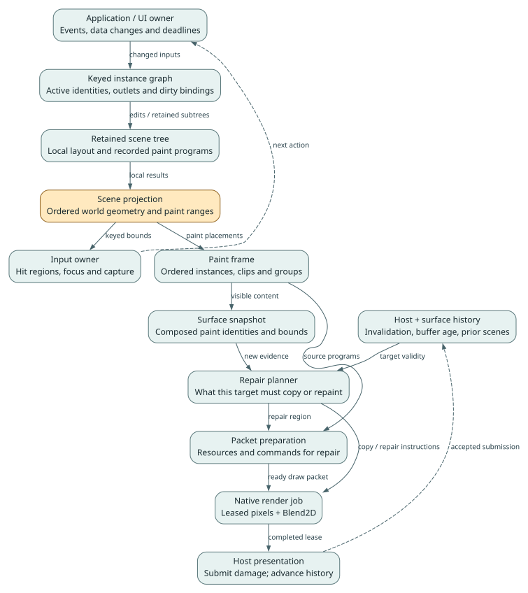

# Render Pipeline

WFGUI and both in-game overlays use the same renderer. Applications describe
content and interactions in Rust. The UI SDK lays them out and records paint;
the renderer prepares resources, repairs the target, and executes Blend2D
commands. Only the host presents the finished buffer.

## From A View To Pixels

1. An observed change invalidates the affected view. The retained instance graph
   preserves keyed identity and applies placement, paint, and interaction updates.
2. A paint program records commands in local coordinates. Its instances bind
   placement and clips. Translating an instance need not rebuild its commands.
3. The acquired target's history and any pixel relocation determine the repair.
   Packet preparation resolves images, fonts and optional raster materializations
   for that demand. Source commands remain available if an optional cache cannot
   be prepared.
4. Intersecting commands replay in painter order; current-frame damage is submitted to the
   compositor separately. Another buffer's valid pixels cannot be assumed.

## Ownership And Feedback

Arrows carry data, not thread switches. The upper half shows a WFGUI page using
the [control host](../../apps/wfgui/src/presentation/controls/mod.rs). The lower
half shows the queued, leased-buffer path. Two distinctions matter:

- **Local identity is not world placement.** A card can keep its key, local
  layout and paint program while its screen position, effective clip and order
  change. Input needs hit bounds and order; it does not need paint commands.
- **A surface snapshot is not a draw packet or a pixel copy.** The
  [snapshot recorder](../../crates/retinue-render/src/surface/snapshot.rs)
  walks frame instances, including nested surfaces, to collect visible bounds,
  identities, content signatures and cost evidence. The
  [surface planner](../../crates/retinue-render/src/surface.rs) compares it to
  the latest submission and consults the acquired buffer's history. Packet
  preparation uses the source frame and resources, **not** the snapshot, to
  produce commands for the chosen repair. If surviving paints change relative
  order, the snapshot comparison conservatively reports full damage. Removing
  or inserting a row need not reorder the survivors.

The front end is not identical across hosts. The [desktop shell](../../apps/wfgui/src/presentation/shell/mod.rs)
composes chrome, the active page and the right rail; Foundry and Settings supply
their own page frames. [Evaluate](../../apps/poe2companion/src/presentation/evaluate/panel.rs)
uses panel layout to record paint sections and populate its own hit targets.
The [Warframe overlay](../../apps/wfcompanion/src/presentation/renderer.rs)
composes relic or kiosk content with transient paint. They meet at surface
evidence, repair and rendering; they do not all pay for a desktop grid update.

## Following A Row Crossing

A row entering a virtual grid changes membership, not just the scroll offset.
Follow the data through its readers to see which work scales with the **changed
rows** and which still scales with the **mounted viewport**.

| Output | What a structural update publishes | Who reads it |
| --- | --- | --- |
| [Keyed view instances](../../crates/retinue-ui/src/ir/graph.rs) | Entering and exiting identities; surviving instances retain their state. | Scene layout and paint bindings. |
| [Scene projection](../../crates/retinue-ui/src/scene/retention.rs) | Dense, ordered geometry and placement records. Restoring a clean subtree skips recording its paint but still copies its records, fixes indices, and updates world positions if it moved. | Named geometry queries, paint placement, and input bounds. |
| [Paint frame](../../crates/retinue-render/src/frame.rs) | Ordered instances and groups referencing retained local paint programs. A new placement is not a new program. | Damage computation and renderer preparation. |
| [Input targets](../../crates/retinue-ui/src/ir/graph/input.rs) | The graph normally publishes targets for its router. WFGUI's [control host](../../apps/wfgui/src/presentation/controls/mod.rs) instead binds page and rail actions to scene geometry and owns their hit testing, capture, and focus. | The router that actually dispatches the event. |

For a scaling investigation, hold the viewport and gesture fixed. Count
entering and surviving items separately, then count what each reader consumes.
Time those stages on the same frame: the cost of restoring records is already
included in geometry time. Compare whole frames before changing ownership.

## What An Update Invalidates

| Scenario | What stays valid | What the implementation still visits |
| --- | --- | --- |
| Idle desktop, no damage or ready work | Last presentation and active views | The [desktop host](../../crates/retinue-ui/src/desktop.rs) can return before preparing a scene or leasing a buffer. A timer deadline is an input, not an unconditional redraw. |
| Scroll, same mounted cards | Keyed membership, local paint programs and unaffected local layout | [Incremental projection](../../crates/retinue-ui/src/scene/projection.rs) walks a moved ancestor's descendant range to resolve absolute placement and clip. No structural restore is necessary. The input owner still needs current hit geometry. |
| Row leaves or enters | Surviving keys and local programs | The graph validates the active topology. Scene publication restores clean subtrees into new dense order; the paint frame reindexes and compares instances. Admission also has to lay out and record new content; retirement does not. |
| New target buffer, same logical content | Layout and paint descriptions | The target may contain older pixels. The surface planner uses buffer history, not scene dirtiness alone, to determine repair. A new or incompatible history can require a full repaint. |

The [listing grid](../../apps/wfgui/src/presentation/listing/grid_view.rs)
already positions cards on a content canvas and sets one offset on its viewport.
Local coordinates, subtree-relative storage indices, and pixel relocation solve
different problems: moving a viewport changes placement, inserting a sibling
can shift indices without moving any pixels, and reusing pixels depends on
what is actually in the acquired buffer.

A shared [translation property](../../crates/retinue-render/src/properties.rs)
is not a retained group placement. Patching it resolves descendant transforms
and clips, collects the affected instances, and updates their screen-space
bounds in the [paint frame](../../crates/retinue-render/src/frame.rs). This is
useful for sharing dependencies, but making a viewport the parent of every
card does not by itself make scrolling constant work. The [geometry reader
experiment](../../tools/benchmarks/README.md#shared-ui-workloads) separates
this publication cost from recording, rasterization and hit testing.

The representation boundary to watch is **keyed local state versus ordered
screen-space output**. A single row edit becomes a viewport-wide operation
because preorder indices, parent and subtree ranges, paint ranges, and resolved
world geometry are published together. The paint frame then builds its own
key-to-position index. Further downstream the shell composes a surface-wide
snapshot even when individual page frames are retained. These are separate
operations with different validity rules; reducing one traversal does not
remove the others.

These are the reader contracts, independent of the storage scheme:

| Edit | Geometry and input | Paint and presentation |
| --- | --- | --- |
| Translate | Keep identities and precedence. Update world bounds and inherited clips, including for a stationary pointer. | Reuse local programs; place them at the new origin. Account for both old and new coverage. |
| Insert | Publish new keys and their hit precedence. Existing siblings need new world geometry only if the layout or an inherited property changed. | Insert programs at the correct painter positions and update containing group ranges. |
| Remove | Retired keys stop resolving in the new publication. Previous positional references cannot silently retarget another control. | Stop replaying the removed instance. Its old pixels still belong to surface history until repaired. |
| Reorder or reparent | Keep surviving identities; update precedence, ancestry, inherited clips and hit policy as applicable. | Preserve overlap order and group membership. Equal bounds and programs do not imply equal pixels after reordering. |

Not all geometry readers can be switched to a key lookup. The
[scene API](../../crates/retinue-ui/src/scene/mod.rs) offers both a keyed lookup
and an ordered slice. The [SDK input router](../../crates/retinue-ui/src/ir/graph/input.rs)
can patch by projection index **only from the immediately preceding geometry
revision**. WFGUI's control host instead looks up actionable bounds by key;
[Foundry](../../apps/wfgui/src/presentation/foundry/composition.rs) also lazily
enumerates the ordered slice when its list of controls is requested.
A different storage layout would need to preserve enumeration and detect
stale positional references, not just make insertion cheaper.

To investigate a change, trace one stable frame, one move and one structural
edit through the same readers. Count identities created, solves, existing
records visited and commands replayed separately. Check both the page trace
and the whole-host path: a page paint benchmark cannot observe the shell
snapshot, buffer history or compositor. Preserve painter order, hit order,
old and new damage, and target validity when comparing alternate designs.

## Optimizer Ownership

Treat the optimizer as cooperating passes throughout the pipeline, not a
mandatory stage between recording and Blend2D. Separate **validity** (would
this plan produce the same result?) from **admission** (is it worth doing?).
IR carries semantic facts used to prove validity: keys, dependencies, placement,
order, clip and resource identity. Buffer contents and native bindings have
their own validity checks downstream. Views can supply facts or hints, not a
prediction that caching will pay off. Optimizer passes may operate *on* the IR
without encoding their decisions *in* it.

| Decision point | Evidence available there | What it decides |
| --- | --- | --- |
| Scene projection | Changed inputs and layout revisions | Which existing programs and placements are still valid. |
| [Packet preparation](../../crates/retinue-render/src/renderer/packet/leaf.rs) | Published plan, font bindings, repeated local repair requests | Build once for reuse, reuse a covered packet, or issue ordinary draws. |
| [Raster planning](../../crates/retinue-render/src/fragments.rs) | Repeated programs, cost, coverage and completed packet use | Promote or release a raster. A packet hit alone is not a fragment draw. |
| [Surface repair](../../crates/retinue-render/src/surface.rs) | Committed scene history and which buffer was acquired | Which pixels can be relocated and what still needs painting. |

Coordination does not require sending every event to a global observer.
Pass bounded evidence directly to its consumer. For example, actual repair
flows from the surface to packet preparation; successful native replay feeds
use counts back to the current publication. Late completion of a superseded
packet cannot train the new one. Sibling renderers already share resource and
execution limits through the [render host](../../crates/retinue-render/src/host.rs).
Scheduling owns worker availability, not paint validity; only the surface
owner can establish whether a particular buffer contains reusable pixels.

**Sharing evidence.** Make a fact available by subject and lifetime, not by
copying a frame's worth of counters into each pass. For example, a packet
request belongs to a renderer and publication; a visible fragment draw belongs
to the program that actually ran. A renderer can remember that recent packets
rarely paid off without treating an expired packet as valid. Keep these
observations out of [`OptimizationContext`](../../crates/retinue-render/src/context.rs):
that type carries comparable, authored annotations. A cache hit must not make
two otherwise identical recordings compare unequal.

For retained packets, [completed-paint evidence](../../crates/retinue-render/src/renderer/evidence.rs)
has one publication owner. Each paint job gathers its own observations; a
successful completion credits each visible subject once. Fragment, layer and
residency planning consume that evidence without fetching it again from the
draw tree. This is one shared interface, not a general frame event log.

The [background replay-index pass](../../crates/retinue-render/src/background.rs)
already shows how to share data across jobs: it reads the immutable program
in place, builds a private index, and [publishes it once](../../crates/retinue-render/src/program.rs)
if the target identity still matches. Follow the same rule for new parallel
passes: borrow existing evidence or share its backing storage, write disjoint
results, and merge at job completion. Only decisions that compete for a shared
budget need host-level arbitration. A pass that cannot see an observation
yet can use the last completed one for cost estimates, never as proof that a
buffer or resource is still valid.

An element can identify a viewport, a repeated item or a reuse opportunity
without promising that caching will be faster. The renderer still checks
coverage, resource identity, clipping and paint order. A hint changes which
plans are considered; it must not change the image.

Optimization already runs on both sides of the paint frame. The
[scene projection](../../crates/retinue-ui/src/scene/projection.rs) can keep a
recorded program when its paint key, size, scale and relevant layout revision
match. Moving an ancestor may still require publishing descendant geometry.
The renderer can separately reuse a raster or a prepared packet; its choice
depends on the acquired buffer's repair and completed paint, neither of which
is known to the view. Pass identity, structure and placement across this
boundary; keep execution feedback with the renderer. To attribute a win, count
recordings, placement updates and packet builds separately for the same edit.

## Raster Planning

Moving already-valid pixels and caching an expensive paint are separate
decisions. A scroll may relocate most of a viewport and repaint an exposed
strip using cached fragments. A small hover change inside the moved region
still needs repair. Transparent overlays and intervening paint can rule out
relocation. See [relocation and repair](render-relocate.md),
[residency](render-residency.md), and [invalidation](ui-invalidation.md).

### Retaining A Viewport Packet

The Relic Planner and Mastery Helper [mount scrollable grids](../../apps/wfgui/src/presentation/listing/retained_grid.rs)
with two distinct lifetimes. Their local layout
and ordered [paint frame](../../crates/retinue-render/src/frame.rs) survive
scrolling while the same cards are mounted. A [draw packet](../../crates/retinue-render/src/renderer/packet.rs)
is a particular way to execute that frame: it leases the fonts and images
selected during preparation and covers a particular repair region. Moving the
viewport invalidates neither the local layout nor the source programs by
itself. It does change which source pixels the acquired buffer needs.

Caching a packet must not hide reuse of its [fragments](../../crates/retinue-render/src/fragments.rs)
and [layers](../../crates/retinue-render/src/layers.rs). If a replay paints an
expensive fragment, it earns the same use credit as an uncached submission.
Counting packet preparations instead would undercount often-replayed content.

The [packet optimizer](../../crates/retinue-render/src/renderer/packet/leaf.rs)
observes nonempty requests on the same publication. A cold request takes the
ordinary path. Initially two successive compatible repeats admit a packet.
When packets expire unused, admission waits longer (at most eight repeats);
multiple hits lower the wait. Replacing the draw plan resets validity and
the current repetition count, not the renderer's history of useful hits.
The page chooses whether to mount a scrollable grid. The renderer, not the
page, decides whether to retain a packet.

1. Express the acquired buffer's repair in viewport-local coordinates. With
   unchanged plan and font bindings, identical demand can reuse the ordered
   draws. Two overlapping, equal-sized rectangles moving on one axis can
   also prepare a span covering the previous, current and one projected
   position. This widens command selection, not raster preparation, the
   parent clip or the area the returned packet is allowed to paint. Changed
   sizes, sparse repairs and frames containing external children do not widen.
2. Account for work that actually runs, equally on packet hits and misses.
   A toolbar-only repair should not warm a card; blitting a cached row is
   not a replay of each fragment inside it. Identical repairs can reuse the
   same usage summary; a smaller or shifted repair cannot simply inherit
   every use in the cached packet. Apply feedback once on successful native
   completion, not additionally during freezing or on compositor presentation.
   Idle, discarded and relocation-only work earns no fragment replay credit.
   The [painter](../../crates/retinue-render/src/painter.rs) records completion
   only after Blend2D finishes. Counts accumulate per subject in that plan;
   the owner consumes them during preparation.
3. A newly worthwhile raster is an optimization, not changed content. The old
   packet can still draw while optional preparation runs. When new bindings
   are published, subsequent submissions can use a replacement; packets
   already in flight keep their leases. Actual content changes must not wait
   for promotion. Neither event requires relayout just to replace a packet.

Recorded programs can still be reused when packet selection misses. Neither
optimization requires an offscreen bitmap or a second input router. Use the
[viewport workloads](../../tools/benchmarks/README.md#shared-ui-workloads)
to distinguish saved layout work, saved packet assembly and native drawing.

The [input placement API](../../crates/retinue-ui/src/input/placement.rs)
is independent of the page and of packet caching. A retained subtree publishes
named hit geometry in its own coordinates. Its parent binds actions at the
subtree's position in paint order, using its translation and clip. A move
shares the local geometry table; it does not transfer focus or pointer capture.
Paint-only changes can also keep the table. Check the scene's input revision
and the published set of named controls; an unchanged clip does not prove
that the same actions are still mounted.
The page still publishes visible controls to its router. It owns modal hit
order, keyboard navigation, capture and accessibility even when the grid moves.

## Execution

Retinue owns the layout tree, invalidation and worker pool. Its
[solver](../../crates/retinue-ui/src/scene/layout/solver.rs) calls
[Taffy's low-level box algorithms](https://docs.rs/taffy/0.12.2/taffy/);
there is no second Taffy tree. A flex or grid calculation requests child
measurements synchronously. A Retinue [uniform grid](../../crates/retinue-ui/src/layout/grid.rs)
already knows its cell bounds and can instead submit independent placements
as [worker batches](../../crates/retinue-ui/src/scene/layout/solver/batch.rs)
when an executor is available. A [text leaf](../../crates/retinue-ui/src/view/text.rs)
measures its paragraph at the proposed width; painting uses its placed glyphs.

Measuring a child during both measurement and placement does not mean it was
laid out twice. The [solver census](../../tools/benchmarks/README.md#shared-ui-workloads)
distinguishes repeated proposals from actual cache misses, including on workers.

Layout and preparation can run off the platform thread. One submitted native
batch uses Blend2D's own participants, including the caller. The platform
owner continues handling input and publishes completed work. Do not add worker
time, owner occupancy and completion waits as if they were serial frame phases.

On the queued desktop path, pending layout yields to the event loop. After a
buffer is leased and repair is planned, [the render job](../../crates/retinue-ui/src/presentation_buffers/render.rs)
owns the target while the packet is prepared and the native pass runs. A wake
lets the host poll completion. An invalidated packet is discarded, not
presented as a successful frame. The [overlay surface host](../../crates/retinue-ui/src/surface.rs)
checks buffer availability before polling application preparation so actionable
geometry is not advanced while all buffers are busy. The desktop path polls
application preparation before it tries to lease the target. A page-only timing
does not include either host's backpressure.

Use the [workload matrix](../../tools/benchmarks/README.md#shared-ui-workloads) to compare
representative frames, and [profiling](profiling.md) to attribute a measured cost.
The [performance history](https://zeewanderer.github.io/retinue/research/benchmarks/)
keeps workload and machine configurations separate.
